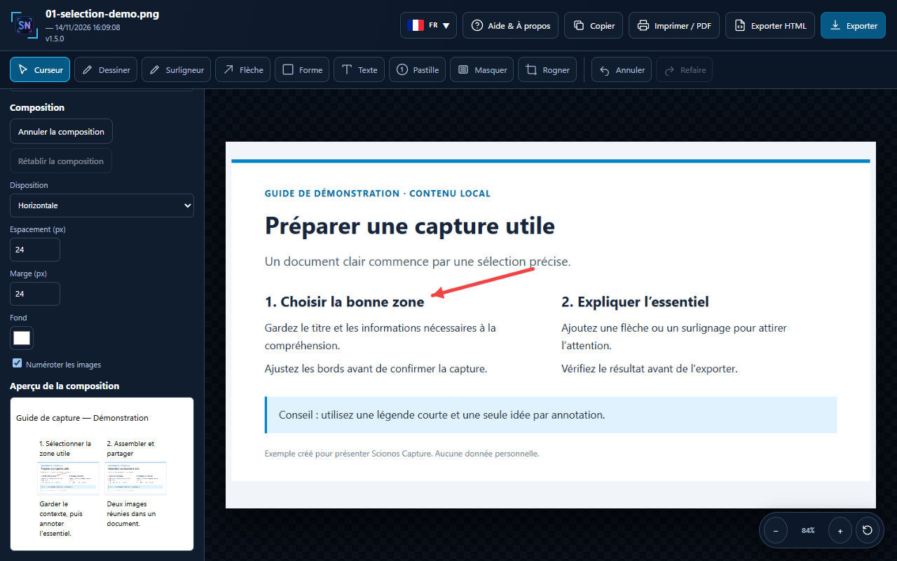

# Scionos Capture 1.5.0

**Capturez une page. Composez un document. Gardez vos données sur votre appareil.**

[Français](#français) · [English](#english) · [Deutsch](#deutsch) · [Español](#español)

## Français

La version 1.5.0 réunit la capture web, la composition multi-images et une bibliothèque locale pour reprendre son travail.

- **Composez vos documents.** Importez ou collez plusieurs images, réordonnez-les et choisissez une disposition, des titres et des légendes.
- **Gardez les annotations éditables.** Enregistrez un projet portable `.scionos` v2. Les projets v1 restent lisibles avec leurs annotations aplaties.
- **Retrouvez vos projets.** La bibliothèque propose vignettes, recherche, renommage, duplication, suppression et réglages de conservation.
- **Choisissez le résultat.** Images, rapport autonome, document avec ses ressources ou impression : les réglages de présentation s’adaptent à l’usage.

**Installation :** téléchargez le ZIP joint et son empreinte SHA-256, vérifiez-la, puis extrayez l’archive. Dans `chrome://extensions` ou `edge://extensions`, activez le mode développeur et choisissez **Charger l’extension non empaquetée**.

**Confidentialité :** le traitement reste local, sans compte ni télémétrie. Utilisez un masque solide pour les secrets ; le flou est uniquement visuel. Masques et rognages deviennent définitifs à la sauvegarde. Vérifiez les métadonnées avant partage.

[Présentation et guide](https://github.com/ScioNos/Scionos-Capture/blob/main/README.md) · [Historique complet](https://github.com/ScioNos/Scionos-Capture/blob/main/CHANGELOG.md)

## English

Version 1.5.0 brings together web capture, multi-image composition and a local library for work you can resume later.

- **Compose documents.** Import or paste images, reorder them and choose a layout, titles and captions.
- **Keep annotations editable.** Save a portable `.scionos` v2 project. Version 1 projects remain readable with flattened annotations.
- **Find your projects.** The library provides thumbnails, search, rename, duplicate, delete and retention settings.
- **Choose the result.** Images, a standalone report, a document with its resources or printing: presentation settings suit the task.

**Installation:** download the attached ZIP and SHA-256 checksum, verify it and extract the archive. In `chrome://extensions` or `edge://extensions`, enable Developer mode and choose **Load unpacked**.

**Privacy:** processing stays local, without an account or telemetry. Use solid masking for secrets; blur is visual only. Masks and crops become permanent on save. Review metadata before sharing.

[Overview and guide](https://github.com/ScioNos/Scionos-Capture/blob/main/README.en.md) · [Full changelog](https://github.com/ScioNos/Scionos-Capture/blob/main/CHANGELOG.en.md)

## Deutsch

Version 1.5.0 verbindet Webaufnahmen, die Zusammenstellung mehrerer Bilder und eine lokale Bibliothek zum späteren Weiterarbeiten.

- **Dokumente zusammenstellen.** Bilder importieren oder einfügen, umordnen und Anordnung, Titel sowie Bildunterschriften wählen.
- **Annotationen bearbeitbar halten.** Ein portables `.scionos`-v2-Projekt speichern. Version-1-Projekte bleiben mit zusammengeführten Annotationen lesbar.
- **Projekte wiederfinden.** Die Bibliothek bietet Vorschaubilder, Suche, Umbenennen, Duplizieren, Löschen und Aufbewahrungseinstellungen.
- **Passende Ergebnisse erstellen.** Bilder, eigenständiger Bericht, Dokument mit Ressourcen oder Ausdruck: Darstellung passend zum Zweck einstellen.

**Installation:** angehängte ZIP-Datei und SHA-256-Prüfsumme herunterladen, prüfen und entpacken. In `chrome://extensions` oder `edge://extensions` den Entwicklermodus aktivieren und **Entpackte Erweiterung laden** wählen.

**Datenschutz:** lokale Verarbeitung ohne Konto oder Telemetrie. Geheimnisse deckend maskieren; Unschärfe ist nur visuell. Masken und Zuschnitte werden beim Speichern dauerhaft angewendet. Metadaten vor dem Teilen prüfen.

[Überblick und Anleitung](https://github.com/ScioNos/Scionos-Capture/blob/main/README.de.md) · [Vollständiges Änderungsprotokoll](https://github.com/ScioNos/Scionos-Capture/blob/main/CHANGELOG.de.md)

## Español

La versión 1.5.0 reúne la captura web, la composición de varias imágenes y una biblioteca local para retomar el trabajo más tarde.

- **Compón documentos.** Importa o pega imágenes, cambia su orden y elige disposición, títulos y leyendas.
- **Conserva las anotaciones editables.** Guarda un proyecto portátil `.scionos` v2. Los proyectos v1 siguen siendo legibles con anotaciones aplanadas.
- **Encuentra tus proyectos.** La biblioteca ofrece miniaturas, búsqueda, cambio de nombre, duplicación, eliminación y ajustes de conservación.
- **Elige el resultado.** Imágenes, informe autónomo, documento con sus recursos o impresión: ajusta la presentación al uso.

**Instalación:** descarga el ZIP adjunto y su suma SHA-256, compruébala y extrae el archivo. En `chrome://extensions` o `edge://extensions`, activa el modo de desarrollador y elige **Cargar descomprimida**.

**Privacidad:** procesamiento local, sin cuenta ni telemetría. Usa una máscara sólida para secretos; el desenfoque solo es visual. Las máscaras y recortes son definitivos al guardar. Revisa los metadatos antes de compartirlos.

[Presentación y guía](https://github.com/ScioNos/Scionos-Capture/blob/main/README.es.md) · [Historial completo](https://github.com/ScioNos/Scionos-Capture/blob/main/CHANGELOG.es.md)

---

**Validation / Verification:** 102 unit tests and 103 browser tests passed for the release source. Native capture smoke tests passed in installed Chrome and Edge for all five capture modes. See [release checks](https://github.com/ScioNos/Scionos-Capture/actions/runs/43611451216).

**Distribution:** this is the GitHub release. Chrome Web Store review and publication are separate; the corrected Store draft awaits owner approval before another submission.

**eyelo SA · ScioNos · Suisse / Switzerland** · [MIT License](https://github.com/ScioNos/Scionos-Capture/blob/main/LICENSE)
