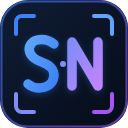
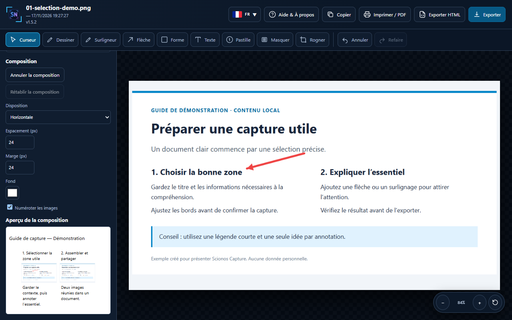
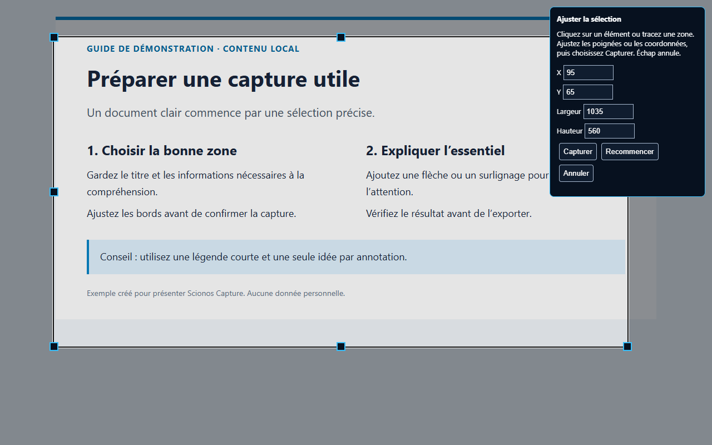
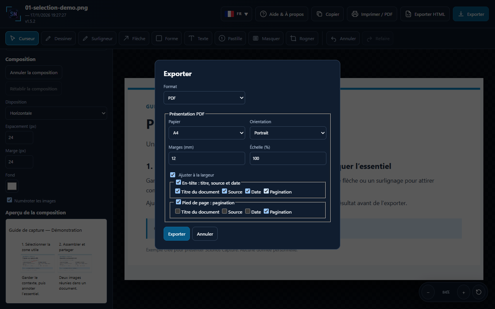
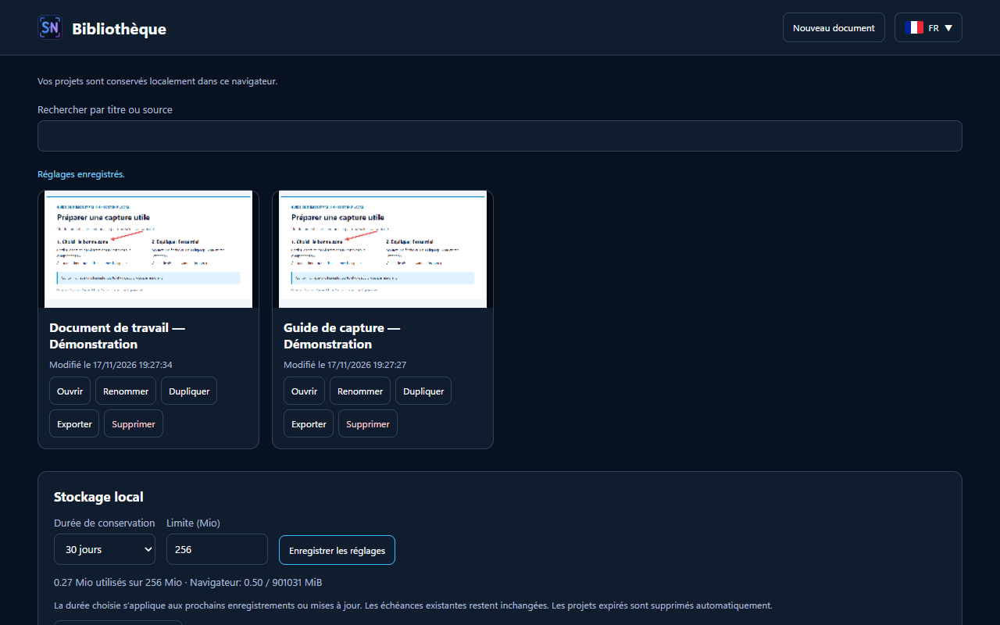

<p align="center">
  
</p>

<h1 align="center">Scionos Capture</h1>

<p align="center"><strong>Seite aufnehmen. Dokument gestalten.<br>Ihre Daten bleiben auf Ihrem Gerät.</strong></p>

<p align="center">Eine lokale Erweiterung für Chrome und Microsoft Edge – von der Aufnahme bis zur Projektbibliothek.</p>

[Français](README.md) · [English](README.en.md) · [Deutsch](README.de.md) · [Español](README.es.md)

[](https://github.com/ScioNos/Scionos-Capture) [](https://github.com/ScioNos/Scionos-Capture/actions/workflows/ci.yml) [](LICENSE) 

**[Version 1.5.2 herunterladen](https://github.com/ScioNos/Scionos-Capture/releases/tag/v1.5.2)** · **[Chrome-Web-Store-Eintrag ansehen](https://chromewebstore.google.com/detail/modfkdhgnhbfilpfanjginilabajchbe)** · **[Hilfe erhalten](https://github.com/ScioNos/Scionos-Capture/issues)**

<!-- source-version --> **1.5.3 — in Vorbereitung, unveröffentlicht.** Das bestehende GitHub-Release behält Tag und bisheriges Archiv; diese neuen Korrekturen sind darin nicht enthalten. Keine Store-Einreichung erfolgt. Siehe [Prüfbericht](STORE_READINESS_1.5.2.md).

## Vorbereitung von 1.5.3 — 26. November 2026

**Abschließende lokale Qualifizierung von 1.5.3 bestanden; unveröffentlichte Version.** Gesamtlauf bestanden: 178 Unit-Tests, 179 E2E-Tests, fünf native Modi in Chrome 158.0.8127.37 und Edge 158.0.4370.33, drei Unterbrechungen je Browser, drei Leistungswiederholungen und zehn PDF-Szenarien. Linux-Prüfungen bestehen auch mit den exakten Node-Mindestversionen 22.22.0 und 24.8.0 (je 178 Unit-Tests). Siehe [Konsolidierungsbericht](RAPPORT_CONSOLIDATION_1.5.3.md). Anwendungs-Commit `3352a12` wird in [PR #1](https://github.com/ScioNos/Scionos-Capture/pull/1) vorgeschlagen, offen und nicht zusammengeführt; die Zusammenführung erfordert eine ausdrückliche Freigabe. Linux-E2E und Windows-Skalierung bestanden auf diesem Commit; Node-22/24-Core-Prüfungen und Filter bestanden auf `81f7849` nach Korrektur der Nachweislinks. Den neuesten SHA zeigen die [PR-Prüfungen](https://github.com/ScioNos/Scionos-Capture/pull/1/checks); ein Gesamterfolg dieses letzten CI-Laufs wird noch nicht behauptet. Endgültiges Archiv: 175.572 Bytes, SHA-256 `f863e10d835425c9023cdb716f7f6bdaa5ce191f34982042417312a50a733d81`. Kein GitHub-Release und keine Store-Einreichung; öffentliche Links von 1.5.2 bleiben erhalten.

- Exportabbruch: Abbrechen und Escape verhindern die Ausgabe auch nach Beginn der Momentaufnahme, während der PDF-Rasterung oder der Bildmodus-Seitenbänder; acht bestandene gezielte Szenarien prüfen temporäre URL-Bereinigung und erneuten Versuch.

- Aufnahme: aktiven Tab, Fenster und Navigation vor und nach der Erfassung prüfen, mit einer an die `documentId` gebundenen Prüfung. URL und Titel werden zu Beginn der Sitzung festgelegt.
- PDF: `captureVisibleTab` liefert keinen Nachweis, dass aufgenommene Pixel und DOM übereinstimmen. Selbst identische beobachtete Zustände vor und nach der Aufnahme können eine vorübergehende Änderung übersehen. Deshalb wird sämtlicher aus dem DOM abgeleiteter Quelltext bei nativen Aufnahmen weggelassen. Text in Benutzerannotationen wird als Pixel gerendert; Titel, Bildunterschriften sowie Kopf- und Fußzeilen bleiben außerhalb des reinen Bildmodus durchsuchbar.
- PDF nur als Bild: Option im Bereich Dokument, in alle vier Sprachen übersetzt und mit den Projekteinstellungen gespeichert. Sie entfernt durchsuchbare Textebenen und rastert auch Kopf- und Fußzeilen. Sichtbare Pixel können weiterhin Geheimnisse enthalten; dieser Modus ersetzt keine deckende Maske.
- Projekte: Manifest auf 1 MiB UTF-8-JSON (einschließlich Escape-Sequenzen), STORE-ZIP-Archiv auf 128 MiB einschließlich Headern und Verzeichnis begrenzt. Eine Vorprüfung lehnt Überschreitungen vor Kopien/Momentaufnahmen ab; der Codec prüft auch die endgültig kodierten Größen. Die Annotationsverläufe für Rückgängig/Wiederholen teilen zusätzlich ein Gesamtbudget von 1 MiB rohem UTF-8-JSON mit einer Reserve pro Zustand. Der Kompositionsverlauf für Titel und Bildunterschriften ist ebenfalls auf 50 Zustände und ein gemeinsames Budget von 1 MiB UTF-8-JSON begrenzt; Änderungen an PDF-Einstellungen und Quellenrichtlinie werden vor der Zustandsänderung geprüft.
- Aufnahmen: Zeitbudget von 180 Sekunden, kooperativ an Kontrollpunkten geprüft, und höchstens 256 Teilaufnahmen. Dies ist keine präemptive Unterbrechung nach 180 Sekunden; zu lange Seiten werden abgelehnt.
- Ressourcen: Das Gesamtbudget von 32 Millionen Pixeln umfasst nach einem Zuschnitt aufbewahrte Originale; Rückgängig/Wiederholen bleibt durch dieses Budget begrenzt. Höchstens zwei Momentaufnahmen sind gleichzeitig in Bearbeitung, bis Export, Kopieren in die Zwischenablage oder Speicherung abgeschlossen ist. Eigene Canvas-Flächen dieser Vorgänge werden in `finally` auf 1 × 1 verkleinert; Eingabeflächen bleiben erhalten.
- Annotationen: 1.000 pro Bild und 5.000 pro Dokument; 10.000 Punkte pro Zeichenstrich und 100.000 pro Dokument. Der globale Verlauf ist auf 100 Zustände, 100.000 Punkte und 5.000 Operationen begrenzt, zusätzlich zum gemeinsamen JSON-Budget.
- Speicherung: Aufnahme-Cache entfernen, um veraltete Daten zwischen Kontexten zu vermeiden; aufgegebene IndexedDB-Verbindungen schließen. Die im lokalen Arbeitsbaum bereits vorhandene transaktionale Gesamtlöschung wird integriert und beibehalten, mit vollständigem Rollback bei Fehlern.
- Importe: strenge Validierung der PNG-Transparenzdaten `tRNS`. Projekte v1/v2 bleiben lesbar, geschrieben wird v2. Keine neue Berechtigung oder Telemetrie.
- Oberfläche: Überlappung der Werkzeugleiste korrigiert; Annotationsbefehle bleiben in derselben 56 px hohen Leiste gruppiert, ohne Verschiebung der Zeichenfläche oder Versatz beim Ziehen. Inaktive Zustände `historyRevision`, `historyConsolidation` und `redoOperations` sind entfernt.
- Kompatibilität: Manifest-Minimum Chrome/Edge 106 statt 102; CSS `:has()` benötigt Chrome 105 und `documentId` Chrome 106. Dieses Minimum wurde statisch ermittelt; die einzigen belegten nativen Ausführungen betreffen Chrome/Edge 158, ohne nachgewiesene Ausführung unter Chrome/Edge 106.
- Werkzeuge: `@axe-core/playwright` 4.14.1, `html-validate` 11.22.1, `minimatch`-Override 11.0.9; inaktiven `glob`-Override entfernt. Zwölf kompatible transitive Aktualisierungen angewendet; GitHub Actions auf Commit-SHAs festgelegt. Siehe [Abhängigkeitsprüfung](DEPENDENCY_REVIEW_1.5.3.md) und [Prüfung der transitiven Abhängigkeiten](DEPENDENCY_TRANSITIVES_1.5.3.md).
- Bibliothek: begrenzte Wiederverwendung von Karten und Miniaturen. Frühere Vergleichsmessungen und ihre Grenzen sind im [Bericht](RAPPORT_CONSOLIDATION_1.5.3.md) dokumentiert; sie belegen keine allgemeine Beschleunigung. Stapelverarbeitung ist nicht implementiert.

## Version 1.5.2 — Korrekturen und Zuverlässigkeit

- Auswahl: aktiven Zeiger verfolgen, weitere Zeiger ignorieren und unterbrochene Gesten bereinigen.
- Aufnahme: ausgeblendete Elemente auch bei Fehlern während der Vorbereitung wiederherstellen.
- Bibliothek: atomare Gesamtlöschung mit Ablehnung veralteter Listen und vollständigem Rollback bei Fehlern.
- Ziehen im Editor: aktiven `pointerId` verfolgen und Unterbrechungen der Geste behandeln.
- Interne Editor-Miniaturen und Kompositionsvorschau: beim erneuten Öffnen des Projekts einschließlich Annotationen rekonstruieren.
- Schaltfläche „Projekt exportieren“: Status ungespeicherter Änderungen beibehalten; die Meldung bestätigt die Download-Anforderung, ohne das Speichern durch den Browser zu garantieren.
- HTML-Berichte: Quellenrichtlinie im gesamten Generator anwenden und HTTP(S)-Zugangsdaten immer entfernen.
- Drucken/PDF: kumulierte Grenzen von 32 Millionen Pixeln und 128 MiB Blobs, höchstens 200 Seiten.
- Paket: altes Modul `editor-export.js` entfernt; damit 35 Distributionsdateien.




*Echte Oberfläche der Version 1.5.2 mit lokalen Demo-Inhalten.*

## Von der Webseite zum Dokument

Erstellen Sie eine visuelle Erklärung, dokumentieren Sie ein Problem oder bewahren Sie einen nützlichen Ausschnitt auf. Scionos Capture vereint Auswahl, Annotation, Komposition und das Fortsetzen von Projekten in einer Erweiterung.

| Präzise aufnehmen | Erklären und gestalten | Arbeit wiederfinden |
| --- | --- | --- |
| Ganze Seite, sichtbarer Bereich, Auswahl, Scrollbereich oder Element per Klick. | Zeichnungen, Text, Pfeile und Masken; mehrere Bilder mit Titeln und Bildunterschriften. | Portable Projekte und lokale Bibliothek mit Suche, Umbenennen und Duplizieren. |

**Ohne Konto, Telemetrie oder Verarbeitungsserver.** Bilder und Metadaten bleiben auf Ihrem Gerät. Sie entscheiden, was Sie speichern und teilen.

## In wenigen Minuten installieren

### Von GitHub herunterladen — Version 1.5.2

1. Laden Sie `scionos-capture-v1.5.2.zip` aus dem [Release v1.5.2](https://github.com/ScioNos/Scionos-Capture/releases/tag/v1.5.2) herunter.
2. Prüfen Sie die Prüfsumme mit der mitgelieferten `.sha256`-Datei und entpacken Sie das Archiv.
3. Öffnen Sie `chrome://extensions` oder `edge://extensions` und aktivieren Sie den **Entwicklermodus**.
4. Wählen Sie **Entpackte Erweiterung laden** und den entpackten Ordner mit dem Manifest aus.
5. Heften Sie Scionos Capture an die Symbolleiste an und öffnen Sie eine normale Webseite.

Ein [Chrome-Web-Store-Eintrag](https://chromewebstore.google.com/detail/modfkdhgnhbfilpfanjginilabajchbe) ist vorhanden. Ausgelieferte Version und Prüfstatus müssen im Dashboard bestätigt werden; hier erfolgt keine Store-Einreichung von 1.5.2.

## Drei Arbeitsabläufe

### 1. Den richtigen Bereich aufnehmen

Wählen Sie einen der fünf Modi, passen Sie die Auswahl mit Griffen oder Koordinaten an und bestätigen Sie. Bei der Elementauswahl können Sie zum über- oder untergeordneten Element wechseln. Eine Verzögerung von **3, 5 oder 10 Sekunden**, mit **Escape** abbrechbar, lässt Zeit, ein Menü oder einen vorübergehenden Zustand vorzubereiten.

Ein Scrollbereich lässt sich mit zwei Punkten oder per Tastatur festlegen. Er behält die gewählte sichtbare Breite bei und setzt die unterstützten Abschnitte vertikal zusammen.

<details>
<summary>Auswahl und Einstellungen ansehen</summary>



</details>

### 2. Annotieren und gestalten

Importieren Sie mehrere Bilder oder fügen Sie sie aus der Zwischenablage ein, ändern Sie ihre Reihenfolge und wählen Sie eine vertikale oder horizontale Anordnung. Ergänzen Sie Titel, Bildunterschriften und nummerierte Schritte; passen Sie Abstände, Ränder und Hintergrund an.

Im Editor können Sie unterstützte Annotationen auswählen und bearbeiten. Zeichnungen, Textmarker, Pfeile, Formen, Text und nummerierte Markierungen helfen beim Erklären; deckende Masken schützen vertrauliche Informationen. Mit Rückgängig/Wiederholen und Zoom verfeinern Sie das Ergebnis.

| Gewünschtes Ergebnis | Möglichkeiten |
| --- | --- |
| Ein Bild zum Teilen | PNG, JPEG oder WebP, Kopieren in die Zwischenablage. |
| Ein Dokument zum Lesen | Eigenständiger HTML-Bericht oder Markdown samt Bildern in einer ZIP-Datei. |
| Eine gedruckte Fassung | Drucken/PDF mit Rändern, Ausrichtung, Skalierung und Kopf-/Fußzeilen. |
| Später weiterarbeiten | Portables `.scionos`-Projekt v2; v1-Projekte lassen sich mit ins Bild eingebetteten Annotationen öffnen. |

<details>
<summary>Export- und Layouteinstellungen ansehen</summary>



</details>

### 3. Projekte speichern und wiederfinden

Die Bibliothek bewahrt Projekte **nach ausdrücklichem Speichern** über das Schließen des Editors hinaus auf. Durchsuchen Sie die Vorschaubilder, suchen Sie nach Titel oder Quelle und öffnen, benennen, duplizieren, exportieren oder löschen Sie ein Projekt.

Wählen Sie eine Aufbewahrungsdauer von **0, 7, 30 oder 90 Tagen** und ein Kontingent von **64 bis 1.024 MiB** — standardmäßig **256 MiB**. **0 Tage** bedeutet keine automatische Löschung nach Ablauf einer Frist. Mit einer portablen Datei behalten Sie eine separate Kopie außerhalb der Bibliothek.



## Datenschutz und Kontrolle über Ihre Daten

- **Lokale Verarbeitung.** Die Erweiterung überträgt keine Aufnahmen, URLs oder Browserdaten an ScioNos oder Dritte. Es wird kein Code aus entfernten Quellen ausgeführt.
- **Selbst gewählte Aufbewahrung.** Temporäre Aufnahmen und Fragmente werden gemäß ihrem Lebenszyklus bereinigt. Bibliotheksprojekte folgen der gewählten Aufbewahrungsdauer; separat gespeicherte Dateien liegen in Ihrer Verantwortung.
- **Deckende Masken für Geheimnisse.** Unschärfe ist ein visueller Effekt. Beim Speichern eines Projekts werden Masken und Zuschnitte unumkehrbar angewendet; betroffene Annotationen werden vorsorglich entfernt. Nach einem Zuschnitt werden vorherige Annotationen ins Bild eingebettet, um Darstellung und Reihenfolge zu erhalten.
- **Quellen kontrollieren.** Im Bereich Dokument entfernt `sanitized` standardmäßig URL-Abfrageparameter und Fragmente; `none` lässt Quellen weg und `full` behält sie bei. In HTTP(S)-URLs eingebettete Zugangsdaten werden immer entfernt. Die Wahl gilt für Projekte und Exporte; beim Speichern entfernte Quellen lassen sich nicht wiederherstellen. Bibliotheksexporte verwenden immer `sanitized`, auch für ältere Projekte.
- **Vor dem Teilen prüfen.** URL-Pfade, Bilder, Titel, Bildunterschriften und Datumsangaben können weiterhin vertraulich sein. Die Diagnose ist lokal und wird ausdrücklich aktiviert, ohne Telemetrie.

Lesen Sie die [Datenschutzerklärung](PRIVACY.de.md) und das [Sicherheitsmodell](SECURITY.de.md).

<details>
<summary>Berechtigungen und temporären Speicher verstehen</summary>

| Berechtigung | Zweck |
| --- | --- |
| `activeTab` und `scripting` | Gewählten Tab aufnehmen und Werkzeuge nach einer ausdrücklichen Aktion injizieren. |
| `storage` | Sprache, Verzögerung, Bibliothekseinstellungen und temporäre Zuordnungen speichern. |
| `unlimitedStorage` | Große Bilder und Projekte lokal speichern; das Anwendungskontingent der Bibliothek bleibt bestehen. |
| `alarms` | Abgelaufene temporäre Daten und Projekte nach Ende ihrer Aufbewahrungsdauer bereinigen. |

Fragmente bleiben in der lokalen IndexedDB und werden nach dem Zusammensetzen oder fünfzehn Minuten Inaktivität gelöscht. Eine fertige Aufnahme bleibt verfügbar, solange ein zugehöriger Editor geöffnet ist, auch nach einem Neuladen. Sie wird beim Schließen des letzten Editors gelöscht; ohne Editor kann sie fünfzehn Minuten nach ihrer Erstellung bereinigt werden. Ein angehaltener Browser kann die Bereinigung bis zum Aufwachen verschieben.

</details>

## Was Sie wissen sollten

- Interne Browserseiten und Erweiterungs-Stores sind gegen das Injizieren von Code geschützt.
- Animierte, virtualisierte oder endlose Inhalte können unvollständig bleiben. Manche festen oder `sticky`-Elemente können zwischen den Abschnitten variieren.
- Die Auswahl durchsucht weder iframe-Inhalte noch geschlossene Shadow Roots.
- PNG-, JPEG- und WebP-Importe über **16 Millionen Pixel** oder **16.384 px pro Seite** werden vor dem Dekodieren abgelehnt statt verkleinert. Das Gesamtlimit der Komposition bleibt bei **32 Millionen Pixel**. Nicht unterstützte Drehungen, Scherungen und perspektivische Transformationen werden ausdrücklich abgelehnt.
- In der lokal qualifizierten Version 1.5.3 liefern native Aufnahmen keine aus dem DOM abgeleitete Quelltextebene: Die API beweist deren Übereinstimmung mit den Pixeln nicht. Importierte Bilder und erneut geöffnete Projekte stellen keine zuverlässige Quelltextebene wieder her. Text in Benutzerannotationen wird als Pixel gerendert; Titel, Bildunterschriften sowie Kopf- und Fußzeilen bleiben außerhalb des Modus „PDF nur als Bild“ durchsuchbar. Diese Option wird in den Projekteinstellungen gespeichert und rastert auch Kopf- und Fußzeilen. Das Bild bleibt erhalten; vertrauliche Pixel müssen deckend maskiert werden, da Unschärfe nur ein visueller Effekt ist.
- Übernehmen oder verwerfen Sie ausstehende Änderungen vor einem Export.

## Entwickeln und beitragen

Oberfläche und Hilfe sind auf **Französisch, Englisch, Deutsch und Spanisch** verfügbar. Das Projekt nutzt Manifest V3 und hat keine externen JavaScript-Laufzeitabhängigkeiten.

Voraussetzung: **Node.js `^22.22.0 || >=24.8.0`**, für Entwicklungs- und Testwerkzeuge wird **Node.js 24.8+ empfohlen**.

```bash
npm ci
npm run verify
```

`verify` prüft Syntax, Lint, HTML, Unit-Tests, Übersetzungen, Paket und Browser-/Barrierefreiheitsregressionen. `npm run test:native` testet die fünf Modi in installiertem Chrome und Edge mit echten Aufnahmen und temporären Profilen, ohne persönliche Profile zu nutzen. `npm run package` erzeugt das Archiv und seine Prüfsumme in `dist/`.

Versionsabgleich für die GitHub-Veröffentlichung: `npm run version:sync -- 1.5.3 --unreleased`; in PowerShell: `npm.cmd run version:sync -- 1.5.3 --unreleased`. Dieser Befehl ändert auch Paketversionsdateien; nur im Rahmen ihrer abgestimmten Aktualisierung ausführen.

Historisches lokales Paket 1.5.2: `dist/scionos-capture-v1.5.2.zip`, 35 Dateien. Die Prüfsumme steht im [Store-Bericht](STORE_READINESS_1.5.2.md) und in der benachbarten `.sha256`-Datei; sie unterscheidet sich vom bestehenden GitHub-Archiv.

<!-- local-package --> Lokales Archiv : `scionos-capture-v1.5.3.zip` · SHA-256 : `scionos-capture-v1.5.3.zip.sha256`.

[Beitragen](CONTRIBUTING.de.md) · [Änderungen](CHANGELOG.de.md) · [Versionshinweise](RELEASE_NOTES.md) · [Problem melden](https://github.com/ScioNos/Scionos-Capture/issues) · [Sicherheitslücke melden](SECURITY.de.md)

---

Entwickelt von **eyelo SA, Schweiz**, unter der Marke **ScioNos**. [Website](https://scionos.ch) · [Kontakt](mailto:info@eyelo.ch) · [MIT-Lizenz](LICENSE)

Historische Prüfungen von 1.5.2: siehe [Abhängigkeitsprüfung](DEPENDENCY_REVIEW_1.5.2.md) und [Bericht zum korrigierten Store-Kandidaten](STORE_READINESS_1.5.2.md). Diese Ergebnisse betreffen frühere Arbeitsstände und qualifizieren 1.5.3 nicht.
