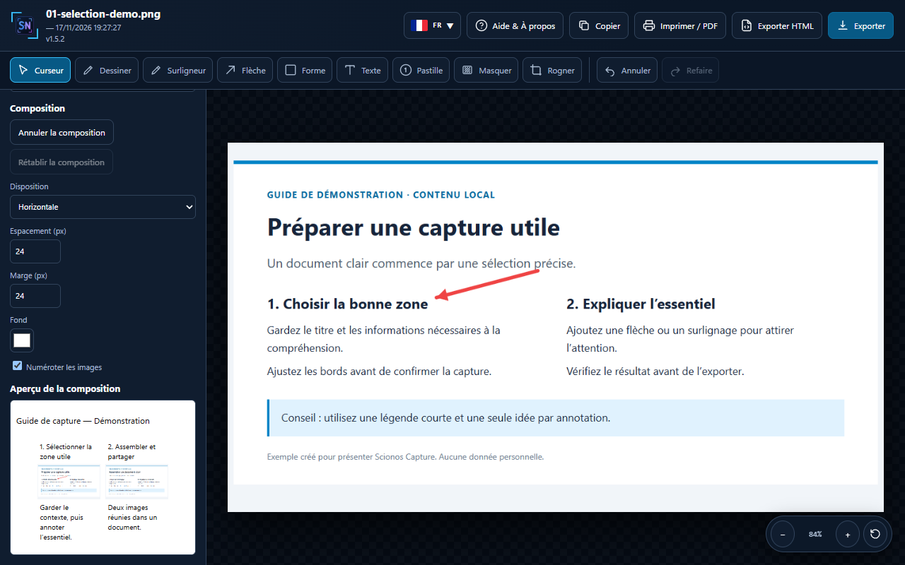
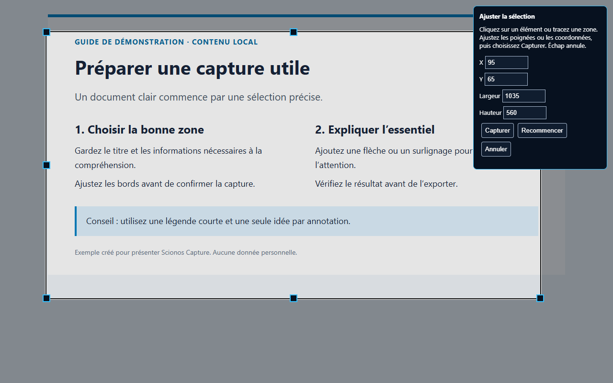
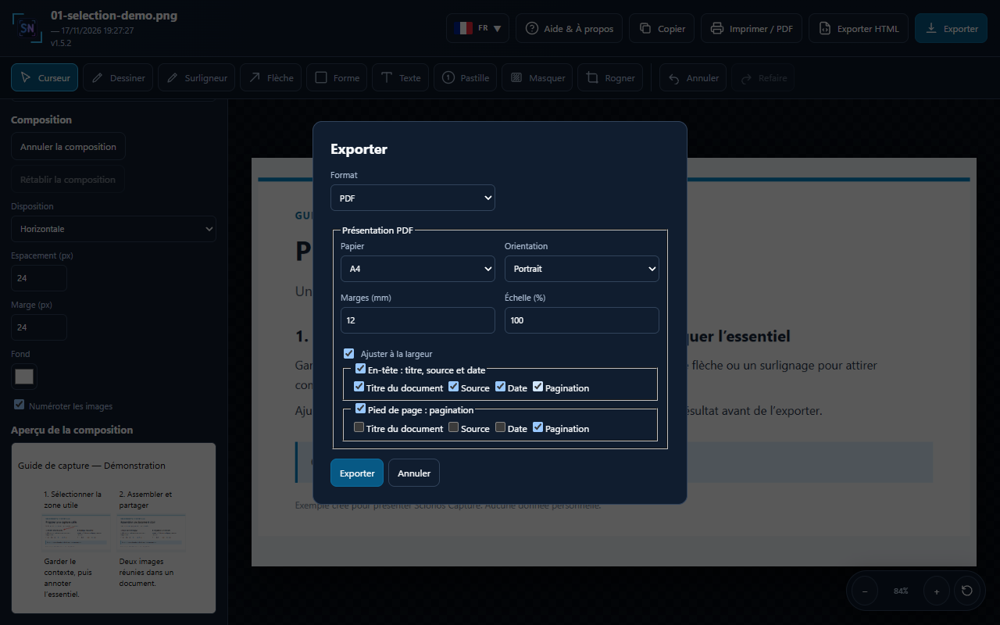
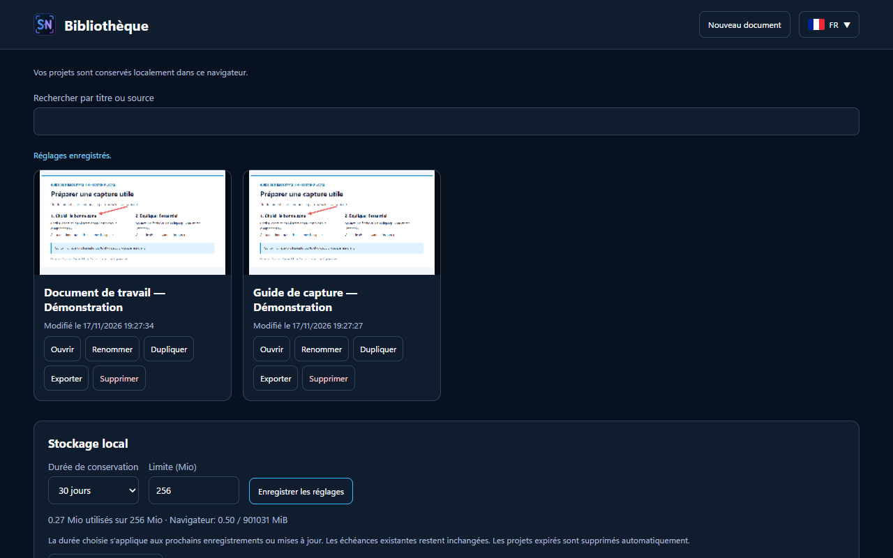

<p align="center">
  
</p>

<h1 align="center">Scionos Capture</h1>

<p align="center"><strong>Capture a page. Build a document.<br>Keep your data on your device.</strong></p>

<p align="center">A local extension for Chrome and Microsoft Edge, from screenshots to a project library.</p>

[Français](README.md) · [English](README.en.md) · [Deutsch](README.de.md) · [Español](README.es.md)

[](https://github.com/ScioNos/Scionos-Capture) [](https://github.com/ScioNos/Scionos-Capture/actions/workflows/ci.yml) [](LICENSE) 

**[Download version 1.5.2](https://github.com/ScioNos/Scionos-Capture/releases/tag/v1.5.2)** · **[View the Chrome Web Store listing](https://chromewebstore.google.com/detail/modfkdhgnhbfilpfanjginilabajchbe)** · **[Get help](https://github.com/ScioNos/Scionos-Capture/issues)**

<!-- source-version --> **1.5.3 — in preparation, unpublished.** The existing GitHub release keeps its tag and earlier archive; it does not contain these new fixes. No Store submission performed. See [the readiness report](STORE_READINESS_1.5.2.md).

## 1.5.3 preparation — November 26, 2026

**Final local 1.5.3 qualification passed; unpublished version.** The complete run passes: 178 unit tests, 179 E2E tests, five native modes in Chrome 158.0.8127.37 and Edge 158.0.4370.33, three interruptions per browser, three performance repetitions and ten PDF scenarios. Linux checks also pass on the exact Node 22.22.0 and 24.8.0 minima (178 unit tests each). See the [consolidation report](RAPPORT_CONSOLIDATION_1.5.3.md). Remote CI, commit/PR and definitive archive remain pending; no GitHub publication or Store submission. Public 1.5.2 links are preserved.

- Export cancellation: Cancel and Escape prevent publication even after snapshot creation starts, during PDF rasterization or image-only page bands; temporary URL cleanup and retry are covered by eight passing targeted scenarios.

- Capture: check the active tab, window and navigation before and after acquisition, with a probe tied to `documentId`. The URL and title are fixed at the start of the session.
- PDF: `captureVisibleTab` provides no evidence that captured pixels match the DOM. Even identical observed states before and after capture can miss a transient change, so all DOM-derived source text is omitted from native captures. User annotation text is rendered into pixels; titles, captions and page bands remain searchable outside image-only mode.
- Image-only PDF: a Document panel option, translated into all four languages and saved with project settings. It removes searchable text layers and rasterizes headers and footers too. Visible pixels may still contain secrets; this mode does not replace a solid mask.
- Projects: the manifest is limited to 1 MiB of UTF-8 JSON (including escapes), and the STORE ZIP archive to 128 MiB including headers and directory. Preflight rejects over-budget states before copies/snapshots; the codec also checks final encoded sizes. Undo/Redo annotation histories additionally share a total 1 MiB budget for raw UTF-8 JSON, with a per-state allowance. Composition history for titles and captions is also limited to 50 states and a shared 1 MiB of UTF-8 JSON; changes to PDF settings and source policy are checked before mutation.
- Captures: a 180-second budget checked cooperatively at checkpoints, and at most 256 portions. This is not a preemptive interruption at 180 seconds; excessively long pages are rejected.
- Resources: a cumulative 32-million-pixel budget includes originals retained after cropping; Undo/Redo remains bounded by this budget. At most two snapshots are in flight simultaneously, until export, clipboard copying or saving finishes. Canvas surfaces owned by these operations are reduced to 1 × 1 in `finally`, preserving input surfaces.
- Annotations: 1,000 per image and 5,000 per document; 10,000 points per stroke and 100,000 per document. Global history is limited to 100 states, 100,000 points and 5,000 operations, in addition to the shared JSON budget.
- Storage: remove the capture cache to avoid stale data across contexts; close abandoned IndexedDB connections. Transactional full deletion already present in the local tree is integrated and preserved, with complete rollback on failure.
- Imports: strictly validate PNG `tRNS` transparency data. Project v1/v2 reading and v2 writing are retained. No new permission or telemetry.
- Interface: fix toolbar overlap; annotation controls stay grouped in the same 56 px toolbar, without canvas shifts or drag offsets. Inert `historyRevision`, `historyConsolidation` and `redoOperations` state is removed.
- Compatibility: manifest minimum Chrome/Edge 106 instead of 102; CSS `:has()` requires Chrome 105 and `documentId` requires Chrome 106. This minimum is identified by static analysis; the only attested native runs concern Chrome/Edge 158, with no demonstrated run on Chrome/Edge 106.
- Tools: `@axe-core/playwright` 4.14.1, `html-validate` 11.22.1, `minimatch` override 11.0.9; inactive `glob` override removed. Twelve compatible transitive updates applied; GitHub Actions pinned to commit SHAs. See the [dependency review](DEPENDENCY_REVIEW_1.5.3.md) and [transitive dependency review](DEPENDENCY_TRANSITIVES_1.5.3.md).
- Library: bounded card and thumbnail reuse. Earlier comparative measurements and their limits are documented in the [report](RAPPORT_CONSOLIDATION_1.5.3.md); they do not establish a general speedup. Batch processing is not implemented.

## Version 1.5.2 — fixes and reliability

- Selections: track the active pointer, ignore secondary pointers and clean up interrupted gestures.
- Capture: restore hidden elements even when their preparation throws.
- Library: atomic bulk deletion, rejecting stale snapshots and rolling back the entire operation on failure.
- Editor drags: track the active `pointerId` and handle gesture interruptions.
- Internal editor thumbnails and composition preview: reconstruct them when reopening a project to include annotations.
- The “Export project” button: keep the unsaved-changes state; the message says the download was requested without guaranteeing that the browser saved the file.
- HTML reports: apply source policy throughout the generator, always removing HTTP(S) credentials.
- Print/PDF: cumulative limits of 32 million pixels and 128 MiB of blobs, with a maximum of 200 pages.
- Package: legacy `editor-export.js` module removed, leaving 35 distribution files.




*Actual version 1.5.2 interface, with local demonstration content.*

## From web page to document

Create a visual explanation, document a problem or save a useful excerpt. Scionos Capture brings selection, annotation, composition and reopening projects together in one extension.

| Capture precisely | Explain and compose | Find your work |
| --- | --- | --- |
| Full page, visible area, selection, scrolling area or element capture with a click. | Drawing, text, arrows and masks; multiple images with titles and captions. | Portable projects and a local library with search, rename and duplicate. |

**No account, telemetry or processing server.** Images and metadata stay on your device. You decide what to save and share.

## Install in minutes

### Download from GitHub — version 1.5.2

1. Download `scionos-capture-v1.5.2.zip` from the [v1.5.2 release](https://github.com/ScioNos/Scionos-Capture/releases/tag/v1.5.2).
2. Verify its checksum using the supplied `.sha256` file, then extract the archive.
3. Open `chrome://extensions` or `edge://extensions` and enable **Developer mode**.
4. Choose **Load unpacked** and select the extracted folder containing the manifest.
5. Pin Scionos Capture to the toolbar and open a regular web page.

An existing [Chrome Web Store listing](https://chromewebstore.google.com/detail/modfkdhgnhbfilpfanjginilabajchbe) is available. Its distributed version and review status must be confirmed in the dashboard; no 1.5.2 Store submission is performed here.

## Three ways to work

### 1. Capture the right area

Choose one of five modes, adjust the selection with handles or coordinates, then confirm. Element selection lets you move to a parent or child element. A **3, 5 or 10-second** delay, cancellable with **Escape**, gives you time to prepare a menu or temporary state.

Define a scrolling area with two points or the keyboard. It keeps the selected visible width and stitches supported sections vertically.

<details>
<summary>View selection tools and settings</summary>



</details>

### 2. Annotate and compose

Import or paste multiple images, reorder them and choose a vertical or horizontal layout. Add titles, captions and numbered steps; adjust spacing, margins and background.

In the editor, select and edit supported annotations. Drawing, highlighter, arrows, shapes, text and numbered markers help explain; solid masks protect confidential information. Undo/Redo and zoom let you refine the result.

| What you need | Options |
| --- | --- |
| An image to share | PNG, JPEG or WebP, copy to clipboard. |
| A document to read | Standalone HTML report or Markdown with its images in a ZIP. |
| A printed version | Print/PDF, with margins, orientation, scale and headers/footers. |
| Work to resume later | Portable `.scionos` v2 project; v1 projects can be opened with flattened annotations. |

<details>
<summary>View export and layout settings</summary>



</details>

### 3. Save and find your projects

The library keeps projects **when you explicitly save them**, even after the editor closes. Browse thumbnails, search by title or source, then reopen, rename, duplicate, export or delete a project.

Choose a retention period of **0, 7, 30 or 90 days** and a quota of **64 to 1,024 MiB** — **256 MiB** by default. **0 days** means no automatic expiration. A portable file lets you keep a separate copy outside the library.



## Privacy and control over your data

- **Local processing.** The extension does not send your screenshots, URLs or browsing data to ScioNos or any third party. No remote code is executed.
- **Storage on your terms.** Temporary captures and chunks are cleaned up according to their lifecycle. Library projects follow your chosen retention period; separately saved files remain your responsibility.
- **Solid masks for secrets.** Blur is a visual effect. When saving a project, masks and crops become irreversible; affected annotations are conservatively removed. After cropping, earlier annotations are flattened to preserve their appearance and order.
- **Source controls.** In the Document panel, `sanitized` removes URL query parameters and fragments by default; `none` omits sources and `full` retains them. Credentials embedded in HTTP(S) URLs are always removed. This choice applies to projects and exports; sources removed on save cannot be restored. Library exports always use `sanitized`, including for older projects.
- **Review before sharing.** URL paths, images, titles, captions and dates may still be sensitive. Diagnostics are local and opt-in, without telemetry.

Read the [privacy policy](PRIVACY.en.md) and [security model](SECURITY.en.md).

<details>
<summary>Understand permissions and temporary storage</summary>

| Permission | Purpose |
| --- | --- |
| `activeTab` and `scripting` | Capture the selected tab and inject tools after an explicit action. |
| `storage` | Remember language, delay, library preferences and temporary associations. |
| `unlimitedStorage` | Store large images and projects locally; the library retains its application quota. |
| `alarms` | Clean up expired temporary data and projects whose retention period has ended. |

Chunks stay in local IndexedDB and are deleted after assembly or fifteen minutes of inactivity. A final capture remains available while a matching editor is open, including after a reload. It is deleted when the last editor closes; without an editor, it becomes eligible for cleanup fifteen minutes after creation. A suspended browser may defer cleanup until it wakes.

</details>

## What to know

- Internal browser pages and extension stores are protected against injection.
- Animated, virtualized or endless content may remain incomplete. Some fixed or `sticky` elements may vary between sections.
- The selector does not traverse iframe contents or closed shadow roots.
- PNG, JPEG and WebP imports exceeding **16 million pixels** or **16,384 px per side** are rejected before decoding instead of being reduced. The total composition limit remains **32 million pixels**. Unsupported rotations, skews and perspective transforms are explicitly rejected.
- For locally qualified 1.5.3, native captures provide no DOM-derived source text layer: the API does not prove its correspondence with the pixels. Imported images and reopened projects do not restore a reliable source text layer. User annotation text is rendered into pixels; titles, captions and page bands remain searchable outside “Image-only PDF” mode. This option is saved in project settings and rasterizes headers and footers too. The image remains present; protect confidential pixels with a solid mask, as blur is only a visual effect.
- Apply or cancel pending edits before exporting.

## Develop and contribute

The interface and help are available in **French, English, German and Spanish**. The project uses Manifest V3 and has no external JavaScript runtime dependencies.

Prerequisite: **Node.js `^22.22.0 || >=24.8.0`**, with **Node.js 24.8+ recommended** for development and test tools.

```bash
npm ci
npm run verify
```

`verify` checks syntax, lint, HTML, unit tests, translations, packaging and browser/accessibility regressions. `npm run test:native` tests all five modes in installed Chrome and Edge with real captures and disposable profiles, without using personal profiles. `npm run package` generates the archive and its checksum in `dist/`.

Version sync for GitHub publication: `npm run version:sync -- 1.5.3 --unreleased`; in PowerShell: `npm.cmd run version:sync -- 1.5.3 --unreleased`. This command also changes package version files; run it only as part of their coordinated update.

Historical local 1.5.2 package: `dist/scionos-capture-v1.5.2.zip`, 35 files. The candidate checksum is recorded in [the Store report](STORE_READINESS_1.5.2.md) and the adjacent `.sha256` file; it differs from the existing GitHub archive.

<!-- local-package --> Local archive : `scionos-capture-v1.5.3.zip` · SHA-256 : `scionos-capture-v1.5.3.zip.sha256`.

[Contribute](CONTRIBUTING.en.md) · [Changelog](CHANGELOG.en.md) · [Release notes](RELEASE_NOTES.md) · [Report an issue](https://github.com/ScioNos/Scionos-Capture/issues) · [Report a vulnerability](SECURITY.en.md)

---

Developed by **eyelo SA, Switzerland**, under the **ScioNos** brand. [Website](https://scionos.ch) · [Contact](mailto:info@eyelo.ch) · [MIT License](LICENSE)

Historical 1.5.2 validations: see the [dependency review](DEPENDENCY_REVIEW_1.5.2.md) and [corrected Store candidate report](STORE_READINESS_1.5.2.md). These results concern earlier states and do not qualify 1.5.3.
