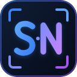
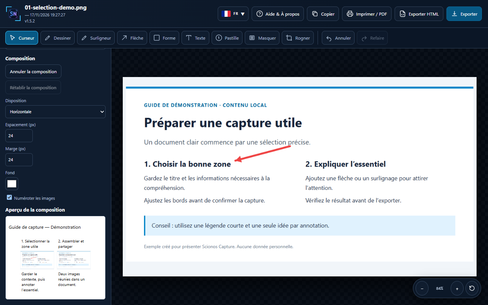
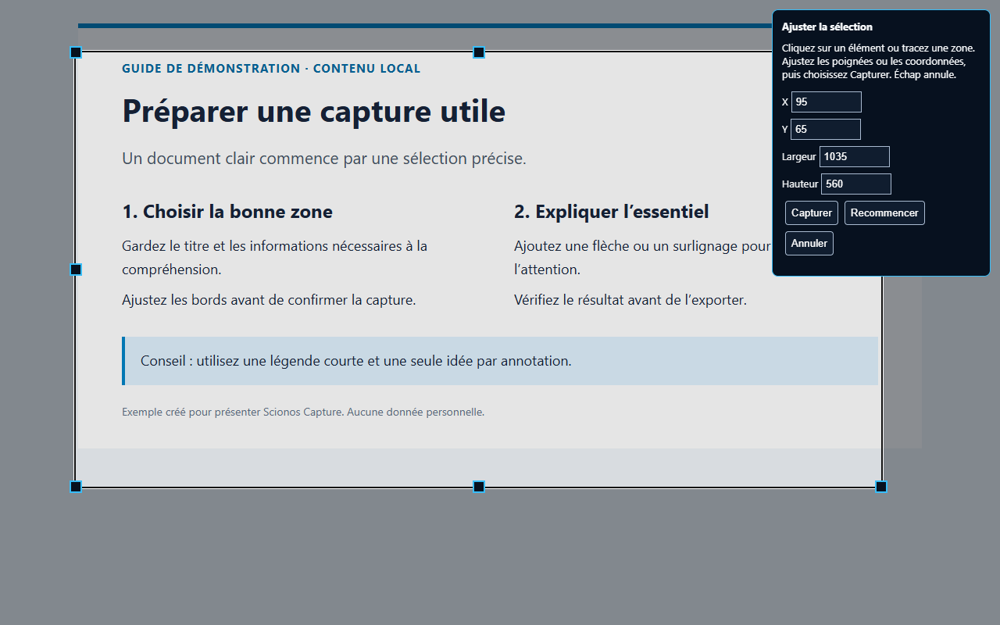
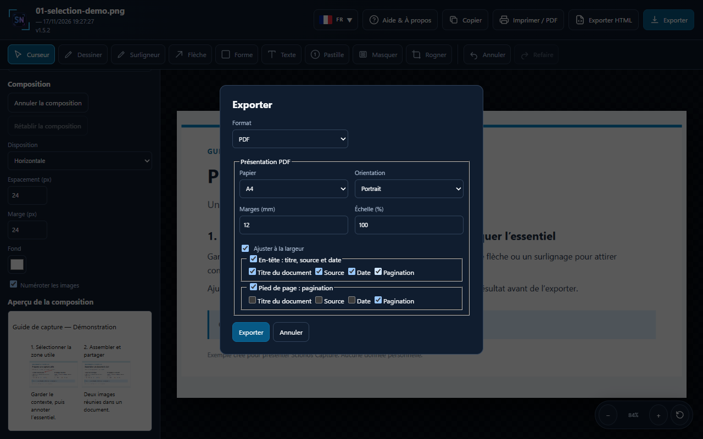
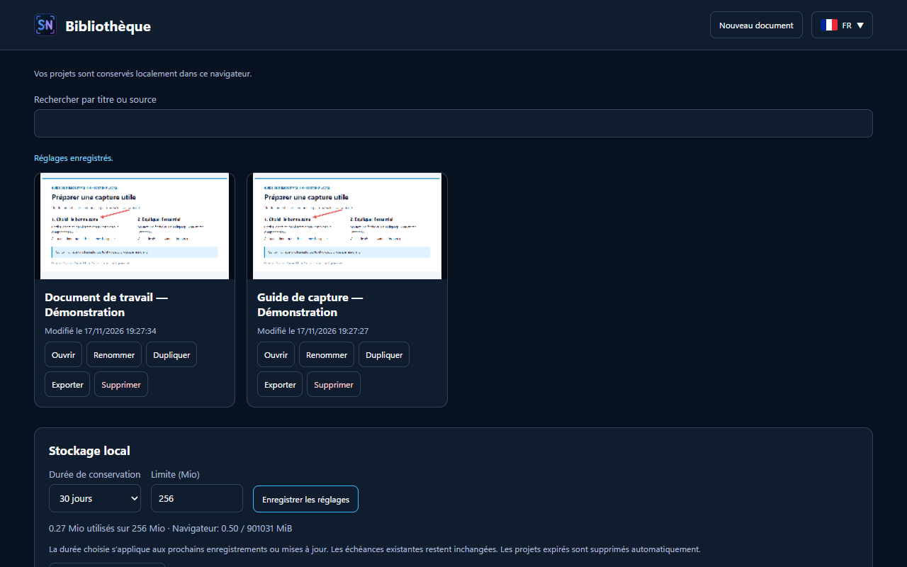

<p align="center">
  
</p>

<h1 align="center">Scionos Capture</h1>

<p align="center"><strong>Captura una página. Compón un documento.<br>Mantén tus datos en tu dispositivo.</strong></p>

<p align="center">Una extensión local para Chrome y Microsoft Edge, desde la captura hasta la biblioteca de proyectos.</p>

[Français](README.md) · [English](README.en.md) · [Deutsch](README.de.md) · [Español](README.es.md)

[](https://github.com/ScioNos/Scionos-Capture) [](https://github.com/ScioNos/Scionos-Capture/actions/workflows/ci.yml) [](LICENSE) 

**[Descargar la versión 1.5.2](https://github.com/ScioNos/Scionos-Capture/releases/tag/v1.5.2)** · **[Ver la ficha de Chrome Web Store](https://chromewebstore.google.com/detail/modfkdhgnhbfilpfanjginilabajchbe)** · **[Obtener ayuda](https://github.com/ScioNos/Scionos-Capture/issues)**

<!-- source-version --> **1.5.3 — en preparación, no publicada.** La publicación GitHub mantiene su etiqueta y archivo anterior; no contiene estas nuevas correcciones. No se ha enviado a la tienda. Véase [el informe de preparación](STORE_READINESS_1.5.2.md).

## Preparación de 1.5.3 — 26 de noviembre de 2026

**Calificación local final de 1.5.3 superada; versión sin publicar.** Campaña completa superada: 178 pruebas unitarias, 179 E2E, cinco modos nativos en Chrome 158.0.8127.37 y Edge 158.0.4370.33, tres interrupciones por navegador, tres repeticiones de rendimiento y diez escenarios PDF. Los controles Linux también pasan con los mínimos exactos Node 22.22.0 y 24.8.0 (178 pruebas unitarias cada uno). Véase el [informe de consolidación](RAPPORT_CONSOLIDATION_1.5.3.md). CI remota, commit/PR y archivo definitivo siguen pendientes; sin publicación GitHub ni envío a la tienda. Se conservan los enlaces públicos de 1.5.2.

- Cancelación de exportaciones: Cancelar y Escape impiden publicar el resultado incluso después de iniciar la instantánea, durante la rasterización PDF o las bandas solo imagen; ocho escenarios específicos superados cubren limpieza de URL temporales y reintento.

- Captura: comprobaciones de pestaña activa, ventana y navegación antes y después de la adquisición, con una sonda vinculada al `documentId`. La URL y el título se fijan al inicio de la sesión.
- PDF: `captureVisibleTab` no aporta pruebas de correspondencia entre los píxeles capturados y el DOM. Incluso con estados observados idénticos antes y después puede pasar inadvertido un cambio transitorio, por lo que se omite todo texto fuente derivado del DOM en las capturas nativas. El texto de las anotaciones del usuario se representa en los píxeles; los títulos, leyendas y bandas de página siguen siendo buscables fuera del modo solo imagen.
- PDF solo imagen: opción del panel Documento, traducida a los cuatro idiomas y guardada con los ajustes del proyecto. Elimina las capas de texto buscable y también rasteriza encabezados y pies de página. Los píxeles visibles aún pueden contener secretos; este modo no sustituye una máscara sólida.
- Proyectos: manifiesto limitado a 1 MiB de JSON UTF-8 (incluidos los escapes) y archivo ZIP STORE a 128 MiB, con cabeceras y directorio incluidos. Una comprobación previa rechaza los excesos antes de copiar o crear instantáneas; el códec comprueba también los tamaños finales codificados. Los historiales de anotaciones Deshacer/Rehacer comparten además un presupuesto total de 1 MiB de JSON bruto UTF-8, con una reserva por estado. El historial de composición de títulos y leyendas también se limita a 50 estados y 1 MiB compartido de JSON UTF-8; los cambios de ajustes PDF y política de fuentes se comprueban antes de modificar el estado.
- Capturas: presupuesto de 180 segundos comprobado de forma cooperativa en los puntos de control y un máximo de 256 porciones. No es una interrupción preventiva a los 180 segundos; las páginas demasiado largas se rechazan.
- Recursos: el presupuesto acumulado de 32 millones de píxeles incluye los originales conservados tras recortar; Deshacer/Rehacer sigue limitado por ese presupuesto. Como máximo hay dos instantáneas simultáneas en curso hasta finalizar la exportación, la copia al portapapeles o el guardado. Los Canvas propios de estas operaciones se reducen a 1 × 1 en `finally`, conservando las superficies de entrada.
- Anotaciones: 1.000 por imagen y 5.000 por documento; 10.000 puntos por trazo y 100.000 por documento. Historial global limitado a 100 estados, 100.000 puntos y 5.000 operaciones, además del presupuesto JSON compartido.
- Almacenamiento: retirada de la caché de capturas para evitar datos obsoletos entre contextos; cierre de conexiones IndexedDB abandonadas. La eliminación total transaccional ya presente en el árbol local se integra y conserva, con reversión completa en caso de error.
- Importaciones: validación estricta de los datos de transparencia PNG `tRNS`. Se conserva la lectura de proyectos v1/v2 y la escritura v2. Sin nuevos permisos ni telemetría.
- Interfaz: corrección del solapamiento de la barra de herramientas; los controles de anotación permanecen agrupados en la misma barra de 56 px, sin desplazar el lienzo ni alterar el arrastre. Se retiran los estados inertes `historyRevision`, `historyConsolidation` y `redoOperations`.
- Compatibilidad: mínimo del manifiesto Chrome/Edge 106 en lugar de 102; CSS `:has()` requiere Chrome 105 y `documentId` Chrome 106. Este mínimo se identifica mediante análisis estático; las únicas ejecuciones nativas acreditadas son en Chrome/Edge 158, sin ejecución demostrada en Chrome/Edge 106.
- Herramientas: `@axe-core/playwright` 4.14.1, `html-validate` 11.22.1, override de `minimatch` 11.0.9; override inactivo de `glob` retirado. Doce actualizaciones transitivas compatibles aplicadas; Actions de GitHub fijadas por SHA de commit. Véanse la [revisión de dependencias](DEPENDENCY_REVIEW_1.5.3.md) y la [revisión de transitivas](DEPENDENCY_TRANSITIVES_1.5.3.md).
- Biblioteca: reutilización limitada de tarjetas y miniaturas. Las mediciones comparativas anteriores y sus límites constan en el [informe](RAPPORT_CONSOLIDATION_1.5.3.md); no demuestran una aceleración general. El procesamiento por lotes no está implementado.

## Versión 1.5.2 — correcciones y fiabilidad

- Selecciones: seguimiento del puntero activo, exclusión de punteros secundarios y limpieza de gestos interrumpidos.
- Captura: restauración de elementos ocultos incluso si falla su preparación.
- Biblioteca: eliminación global atómica, con rechazo de listas obsoletas y reversión completa en caso de error.
- Arrastres en el editor: seguimiento del `pointerId` activo y gestión de interrupciones del gesto.
- Miniaturas internas del editor y vista previa de composición: reconstrucción al reabrir el proyecto para incluir las anotaciones.
- Botón «Exportar proyecto»: se mantiene el estado de cambios sin guardar; el mensaje indica que se ha solicitado la descarga sin garantizar que el navegador haya guardado el archivo.
- Informes HTML: aplicación de la política de fuentes en todo el generador, eliminando siempre las credenciales HTTP(S).
- Impresión/PDF: límites acumulados de 32 millones de píxeles y 128 MiB de blobs, con un máximo de 200 páginas.
- Paquete: módulo antiguo `editor-export.js` retirado, con 35 archivos de distribución.




*Interfaz real de la versión 1.5.2, con contenido de demostración local.*

## De la página web al documento

Prepara una explicación visual, documenta un problema o conserva un fragmento útil. Scionos Capture reúne la selección, la anotación, la composición y la reanudación de proyectos en una sola extensión.

| Capturar con precisión | Explicar y componer | Recuperar tu trabajo |
| --- | --- | --- |
| Página completa, área visible, selección, área desplazable o elemento con un clic. | Dibujo, texto, flechas y máscaras; varias imágenes con títulos y leyendas. | Proyectos portátiles y biblioteca local con búsqueda, cambio de nombre y duplicación. |

**Sin cuenta, telemetría ni servidor de procesamiento.** Las imágenes y los metadatos permanecen en tu dispositivo. Tú decides qué guardas y compartes.

## Instalar en pocos minutos

### Descargar desde GitHub — versión 1.5.2

1. Descarga `scionos-capture-v1.5.2.zip` de la [versión v1.5.2](https://github.com/ScioNos/Scionos-Capture/releases/tag/v1.5.2).
2. Verifica su suma de comprobación con el archivo `.sha256` incluido y extrae el archivo comprimido.
3. Abre `chrome://extensions` o `edge://extensions` y activa el **Modo de desarrollador**.
4. Elige **Cargar descomprimida** y selecciona la carpeta extraída que contiene el manifiesto.
5. Fija Scionos Capture en la barra de herramientas y abre una página web normal.

Existe una [ficha de Chrome Web Store](https://chromewebstore.google.com/detail/modfkdhgnhbfilpfanjginilabajchbe). Su versión distribuida y su estado de revisión deben confirmarse en el panel; aquí no se realiza ningún envío de la 1.5.2 a la tienda.

## Tres formas de trabajar

### 1. Capturar el área adecuada

Elige uno de los cinco modos, ajusta la selección con tiradores o coordenadas y confirma. La selección de elementos permite pasar al elemento padre o hijo. Un retardo de **3, 5 o 10 segundos**, cancelable con **Escape**, te da tiempo para preparar un menú o un estado temporal.

Puedes definir un área desplazable con dos puntos o mediante el teclado. Mantiene el ancho visible elegido y ensambla verticalmente las partes compatibles.

<details>
<summary>Ver la selección y sus ajustes</summary>



</details>

### 2. Anotar y componer

Importa o pega varias imágenes, cambia su orden y elige una disposición vertical u horizontal. Añade títulos, leyendas y pasos numerados; ajusta el espaciado, los márgenes y el fondo.

En el editor, selecciona y modifica las anotaciones compatibles. Dibujo, resaltador, flechas, formas, texto y marcadores numerados ayudan a explicar; las máscaras sólidas protegen la información confidencial. Deshacer/Rehacer y el zoom permiten afinar el resultado.

| Resultado deseado | Opciones |
| --- | --- |
| Una imagen para compartir | PNG, JPEG o WebP, copia al portapapeles. |
| Un documento para consultar | Informe HTML autónomo o Markdown con sus imágenes en un ZIP. |
| Una versión impresa | Impresión/PDF, con márgenes, orientación, escala y encabezados/pies de página. |
| Un trabajo para retomar | Proyecto portátil `.scionos` v2; lectura de proyectos v1 con anotaciones aplanadas. |

<details>
<summary>Ver los ajustes de exportación y presentación</summary>



</details>

### 3. Guardar y encontrar tus proyectos

La biblioteca conserva los proyectos **cuando los guardas explícitamente**, incluso después de cerrar el editor. Recorre las miniaturas, busca por título o fuente y vuelve a abrir, renombra, duplica, exporta o elimina un proyecto.

Elige una duración de **0, 7, 30 o 90 días** y una cuota de **64 a 1.024 MiB** — **256 MiB** por defecto. **0 días** significa sin caducidad automática. Un archivo portátil permite conservar una copia separada de la biblioteca.



## Privacidad y control de los datos

- **Procesamiento local.** La extensión no transmite tus capturas, URL ni datos de navegación a ScioNos ni a terceros. No se ejecuta código remoto.
- **Conservación a tu elección.** Las capturas temporales y los fragmentos se limpian según su ciclo de vida. Los proyectos de la biblioteca siguen la retención elegida; los archivos guardados por separado quedan bajo tu responsabilidad.
- **Máscaras sólidas para los secretos.** El desenfoque es un efecto visual. Al guardar un proyecto, las máscaras y los recortes se vuelven irreversibles; las anotaciones afectadas se eliminan de forma conservadora. Tras un recorte, las anotaciones anteriores se aplanan para preservar su aspecto y orden.
- **Control de fuentes.** En el panel Documento, `sanitized` elimina por defecto los parámetros de consulta y fragmentos de las URL; `none` omite las fuentes y `full` las conserva. Las credenciales incluidas en las URL HTTP(S) siempre se eliminan. La elección se aplica a proyectos y exportaciones; una fuente eliminada al guardar no se puede recuperar. La exportación desde la biblioteca siempre usa `sanitized`, incluso para proyectos antiguos.
- **Revisión antes de compartir.** Las rutas de las URL, imágenes, títulos, leyendas y fechas aún pueden ser sensibles. El diagnóstico es local y de activación voluntaria, sin telemetría.

Consulta la [política de privacidad](PRIVACY.es.md) y el [modelo de seguridad](SECURITY.es.md).

<details>
<summary>Entender los permisos y el almacenamiento temporal</summary>

| Permiso | Uso |
| --- | --- |
| `activeTab` y `scripting` | Capturar la pestaña elegida e inyectar las herramientas tras una acción explícita. |
| `storage` | Recordar idioma, retardo, preferencias de la biblioteca y asociaciones temporales. |
| `unlimitedStorage` | Guardar localmente imágenes y proyectos grandes; la biblioteca mantiene su cuota de aplicación. |
| `alarms` | Limpiar los datos temporales caducados y los proyectos cuyo plazo de conservación haya terminado. |

Los fragmentos permanecen en IndexedDB local y se eliminan tras el ensamblado o quince minutos de inactividad. Una captura final sigue disponible mientras haya un editor correspondiente abierto, incluso después de recargar. Se elimina al cerrar el último editor; sin editor, puede limpiarse quince minutos después de su creación. Un navegador suspendido puede aplazar la limpieza hasta que se reactive.

</details>

## Lo que conviene saber

- Las páginas internas del navegador y las tiendas de extensiones están protegidas contra la inyección.
- El contenido animado, virtualizado o sin fin puede quedar incompleto. Algunos elementos fijos o `sticky` pueden variar entre las partes.
- El selector no recorre el interior de los iframes ni los shadow roots cerrados.
- Las importaciones PNG, JPEG y WebP que superen **16 millones de píxeles** o **16.384 px por lado** se rechazan antes de decodificar, en vez de reducirse. El límite acumulado de composición sigue siendo de **32 millones de píxeles**. Las rotaciones, inclinaciones y transformaciones de perspectiva no compatibles se rechazan explícitamente.
- En la 1.5.3 calificada localmente, las capturas nativas no aportan una capa de texto fuente derivada del DOM: la API no demuestra su correspondencia con los píxeles. Las imágenes importadas y los proyectos reabiertos no restauran una capa fuente fiable. El texto de las anotaciones del usuario se representa en los píxeles; los títulos, leyendas y bandas de página siguen siendo buscables fuera del modo «PDF solo imagen». Esta opción se guarda en los ajustes del proyecto y también rasteriza encabezados y pies de página. La imagen permanece; protege los píxeles confidenciales con una máscara sólida, ya que el desenfoque es solo visual.
- Aplica o cancela los cambios pendientes antes de exportar.

## Desarrollar y contribuir

La interfaz y la ayuda están disponibles en **francés, inglés, alemán y español**. El proyecto utiliza Manifest V3 y no tiene dependencias externas de JavaScript en tiempo de ejecución.

Requisito: **Node.js `^22.22.0 || >=24.8.0`**, con **Node.js 24.8+ recomendado** para las herramientas de desarrollo y pruebas.

```bash
npm ci
npm run verify
```

`verify` comprueba sintaxis, lint, HTML, pruebas unitarias, traducciones, paquete y regresiones del navegador y de accesibilidad. `npm run test:native` prueba los cinco modos en Chrome y Edge instalados con capturas reales y perfiles temporales, sin usar perfiles personales. `npm run package` genera el archivo comprimido y su suma de comprobación en `dist/`.

Sincronización de versión para la publicación GitHub: `npm run version:sync -- 1.5.3 --unreleased`; en PowerShell: `npm.cmd run version:sync -- 1.5.3 --unreleased`. Este comando también modifica los archivos de versión del paquete; ejecútalo solo dentro de su actualización coordinada.

Paquete local histórico 1.5.2: `dist/scionos-capture-v1.5.2.zip`, 35 archivos. La suma de esta candidata consta en [el informe](STORE_READINESS_1.5.2.md) y en el archivo `.sha256` adjunto; difiere del archivo GitHub existente.

<!-- local-package --> Archivo local : `scionos-capture-v1.5.3.zip` · SHA-256 : `scionos-capture-v1.5.3.zip.sha256`.

[Contribuir](CONTRIBUTING.es.md) · [Cambios](CHANGELOG.es.md) · [Notas de versión](RELEASE_NOTES.md) · [Informar de un problema](https://github.com/ScioNos/Scionos-Capture/issues) · [Informar de una vulnerabilidad](SECURITY.es.md)

---

Desarrollado por **eyelo SA, Suiza**, bajo la marca **ScioNos**. [Sitio web](https://scionos.ch) · [Contacto](mailto:info@eyelo.ch) · [Licencia MIT](LICENSE)

Validaciones históricas de 1.5.2: véanse la [revisión de dependencias](DEPENDENCY_REVIEW_1.5.2.md) y el [informe de la candidata corregida para la tienda](STORE_READINESS_1.5.2.md). Estos resultados corresponden a estados anteriores y no califican la 1.5.3.
