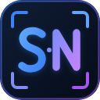
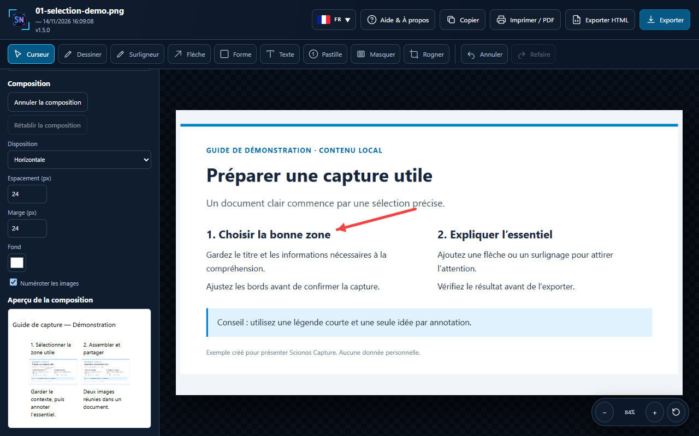
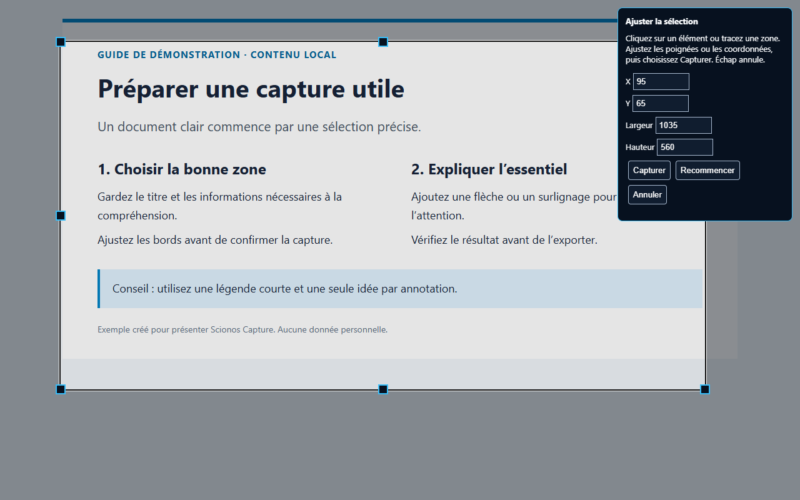
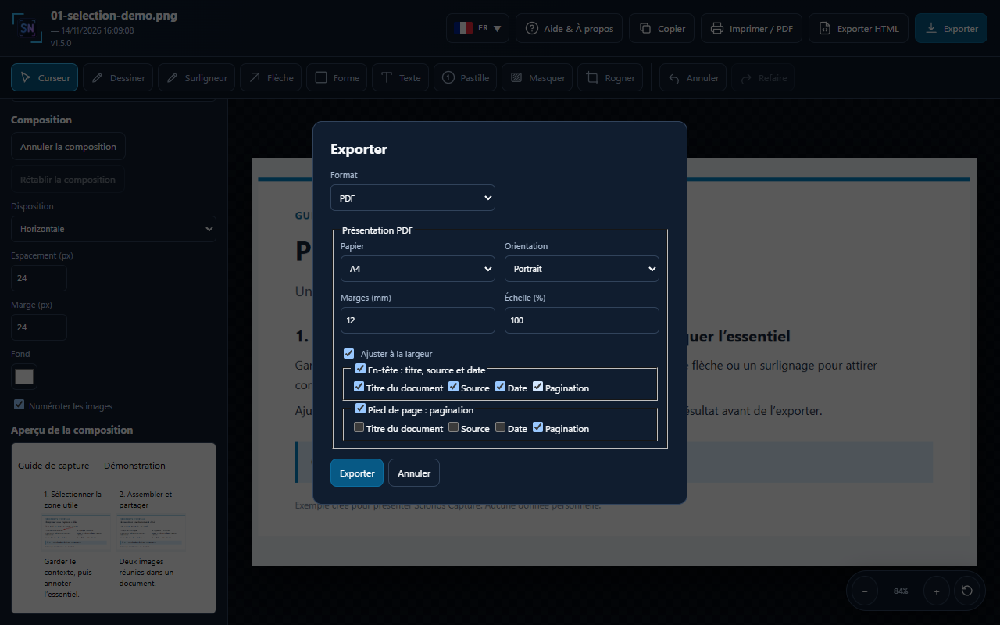
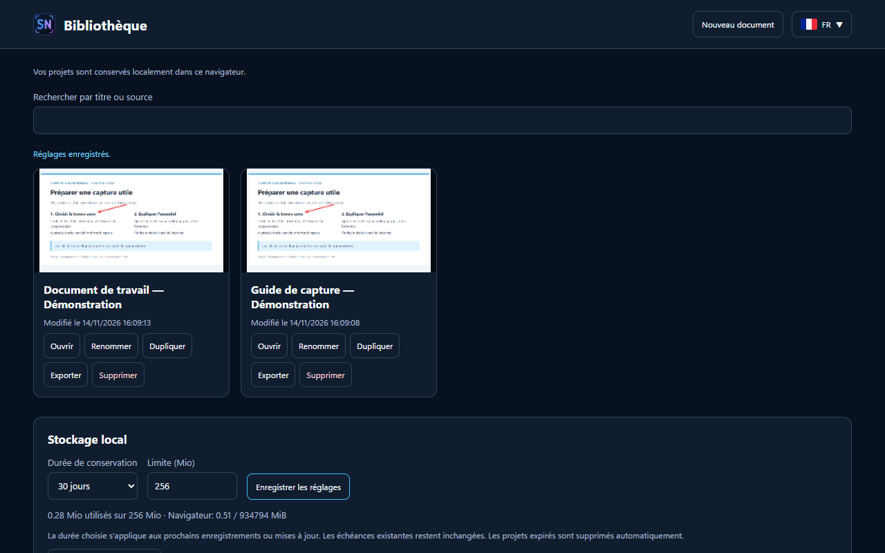

<p align="center">
  
</p>

<h1 align="center">Scionos Capture</h1>

<p align="center"><strong>Capturez une page. Composez un document.<br>Gardez vos données sur votre appareil.</strong></p>

<p align="center">Une extension locale pour Chrome et Microsoft Edge, de la capture à la bibliothèque de projets.</p>

[Français](README.md) · [English](README.en.md) · [Deutsch](README.de.md) · [Español](README.es.md)

[](https://github.com/ScioNos/Scionos-Capture/releases/tag/v1.5.0) [](https://github.com/ScioNos/Scionos-Capture/actions/workflows/ci.yml) [](LICENSE) 

**[Télécharger la version 1.5.0](https://github.com/ScioNos/Scionos-Capture/releases/tag/v1.5.0)** · **[Voir la fiche Chrome Web Store](https://chromewebstore.google.com/detail/modfkdhgnhbfilpfanjginilabajchbe)** · **[Obtenir de l’aide](https://github.com/ScioNos/Scionos-Capture/issues)**

<!-- source-version --> Version 1.5.0 disponible sur GitHub. La mise à jour de la fiche Chrome Web Store est en préparation ; sa version peut différer de celle du dépôt.



*Interface réelle de la version 1.5.0, avec un contenu de démonstration local.*

## De la page web au document

Préparez une explication visuelle, documentez un problème ou conservez un extrait utile. Scionos Capture réunit la sélection, l’annotation, la composition et la reprise de projets dans une même extension.

| Capturer précisément | Expliquer et composer | Retrouver son travail |
| --- | --- | --- |
| Page entière, zone visible, sélection, région défilante ou élément au clic. | Dessin, texte, flèches et masques ; plusieurs images avec titres et légendes. | Projets portables et bibliothèque locale avec recherche, renommage et duplication. |

**Sans compte, télémétrie ni serveur de traitement.** Les images et métadonnées restent sur l’appareil. Vous décidez de ce que vous enregistrez et partagez.

## Installer en quelques minutes

### Depuis GitHub — version 1.5.0

1. Téléchargez `scionos-capture-v1.5.0.zip` depuis la [release v1.5.0](https://github.com/ScioNos/Scionos-Capture/releases/tag/v1.5.0).
2. Vérifiez son empreinte avec le fichier `.sha256` fourni, puis extrayez l’archive.
3. Ouvrez `chrome://extensions` ou `edge://extensions` et activez le **Mode développeur**.
4. Choisissez **Charger l’extension non empaquetée** et sélectionnez le dossier extrait contenant le manifeste.
5. Épinglez Scionos Capture dans la barre d’outils et ouvrez une page web ordinaire.

La [fiche Chrome Web Store](https://chromewebstore.google.com/detail/modfkdhgnhbfilpfanjginilabajchbe) permet l’installation depuis la boutique. Vérifiez la version qui y est proposée : la publication GitHub et la validation Google suivent deux circuits distincts.

## Trois façons de travailler

### 1. Capturer la bonne zone

Choisissez l’un des cinq modes, ajustez la sélection par poignées ou coordonnées, puis confirmez. La sélection d’un élément permet de remonter vers son parent ou de choisir son enfant. Un délai de **3, 5 ou 10 secondes**, annulable avec **Échap**, laisse le temps de préparer un menu ou un état temporaire.

Une zone défilante peut être définie par deux points ou au clavier. Elle conserve la largeur visible choisie et assemble verticalement les portions prises en charge.

<details>
<summary>Voir la sélection et ses réglages</summary>



</details>

### 2. Annoter et composer

Importez ou collez plusieurs images, changez leur ordre et choisissez une disposition verticale ou horizontale. Ajoutez titres, légendes et étapes numérotées ; ajustez l’espacement, les marges et le fond.

Dans l’éditeur, sélectionnez et modifiez les annotations prises en charge. Dessin, surligneur, flèches, formes, texte et pastilles servent à expliquer ; le masque solide sert à protéger les informations confidentielles. Annuler/Refaire et le zoom permettent d’affiner le résultat.

| Résultat souhaité | Possibilités |
| --- | --- |
| Une image à partager | PNG, JPEG ou WebP, copie dans le presse-papiers. |
| Un document à consulter | Rapport HTML autonome ou Markdown accompagné de ses images dans un ZIP. |
| Une version imprimée | Impression/PDF, avec marges, orientation, échelle et en-têtes/pieds de page. |
| Un travail à reprendre | Projet portable `.scionos` v2 ; lecture des projets v1 avec annotations aplaties. |

<details>
<summary>Voir les réglages d’export et de présentation</summary>



</details>

### 3. Enregistrer et retrouver ses projets

La bibliothèque conserve les projets **sur enregistrement explicite**, au-delà de la fermeture de l’éditeur. Parcourez les vignettes, recherchez par titre ou source, puis rouvrez, renommez, dupliquez, exportez ou supprimez un projet.

Choisissez une durée de **0, 7, 30 ou 90 jours** et un quota de **64 à 1 024 Mio** — **256 Mio** par défaut. Le choix **0 jour** signifie sans expiration automatique. Un fichier portable permet de conserver une copie séparée de la bibliothèque.



## Confidentialité et maîtrise des données

- **Traitement local.** L’extension ne transmet pas vos captures, URL ou données de navigation à ScioNos ou à un tiers. Aucun code distant n’est exécuté.
- **Conservation choisie.** Les captures temporaires et fragments sont nettoyés selon leur cycle de vie. Les projets de bibliothèque suivent la rétention choisie ; les fichiers enregistrés séparément restent sous votre responsabilité.
- **Masquage solide pour les secrets.** Le flou est un effet visuel. À la sauvegarde d’un projet, masques et rognages deviennent irréversibles ; les annotations touchées sont retirées de manière conservative. Après rognage, les annotations antérieures sont aplaties pour préserver leur rendu et leur ordre.
- **Vérification avant partage.** Les projets et exports peuvent contenir images, titres, légendes, sources et dates.

Consultez la [politique de confidentialité](PRIVACY.md) et le [modèle de sécurité](SECURITY.md).

<details>
<summary>Comprendre les permissions et le stockage temporaire</summary>

| Permission | Usage |
| --- | --- |
| `activeTab` et `scripting` | Capturer l’onglet choisi et injecter les outils après une action explicite. |
| `storage` | Mémoriser langue, délai, préférences de bibliothèque et associations temporaires. |
| `unlimitedStorage` | Conserver localement les grandes images et projets ; la bibliothèque garde son quota applicatif. |
| `alarms` | Nettoyer les données temporaires expirées et les projets arrivés à échéance. |

Les fragments restent dans IndexedDB local et sont supprimés après assemblage ou quinze minutes sans activité. Une capture finale reste disponible tant qu’un éditeur correspondant est ouvert, y compris après rechargement. Elle est supprimée à la fermeture du dernier éditeur ; sans éditeur, elle devient éligible au nettoyage quinze minutes après sa création. Un navigateur suspendu peut différer le nettoyage jusqu’à son réveil.

</details>

## Ce qu’il faut savoir

- Les pages internes du navigateur et les boutiques d’extensions sont protégées contre l’injection.
- Les contenus animés, virtualisés ou sans fin peuvent rester incomplets. Certains éléments fixes ou `sticky` peuvent varier entre les portions.
- Le sélecteur ne parcourt pas l’intérieur des iframes ni les shadow roots fermés.
- Les images dépassant **16 millions de pixels** ou **16 384 px par côté** peuvent être réduites. Les rotations, inclinaisons et perspectives non prises en charge sont refusées explicitement.
- Le texte recherchable d’un PDF est conservé uniquement lorsque sa visibilité est vérifiable. Les images importées et restaurées d’un projet ne fournissent pas de couche texte fiable ; les mots incertains sont omis de la couche textuelle, sans retirer l’image.
- Validez ou annulez les modifications en attente avant un export.

## Développer et contribuer

L’interface et l’aide existent en **français, anglais, allemand et espagnol**. Le projet utilise Manifest V3 et n’a aucune dépendance JavaScript d’exécution externe.

Prérequis conseillé : **Node.js 24**. Les contrôles principaux restent compatibles avec Node.js 20.

```bash
npm ci
npm run verify
```

`verify` contrôle la syntaxe, le lint, le HTML, les tests unitaires, les traductions, le paquet et les régressions navigateur/accessibilité. `npm run test:native` teste les cinq modes dans Chrome et Edge installés avec de vraies captures et des profils jetables, sans profil personnel. `npm run package` génère l’archive et son empreinte dans `dist/`.

Synchronisation de version : `npm run version:sync -- 1.5.0` ; sous PowerShell : `npm.cmd run version:sync -- 1.5.0`.

<!-- local-package --> Archive locale : scionos-capture-v1.5.0.zip · SHA-256 : scionos-capture-v1.5.0.zip.sha256.

[Contribuer](CONTRIBUTING.md) · [Changements](CHANGELOG.md) · [Notes de version](RELEASE_NOTES.md) · [Signaler un problème](https://github.com/ScioNos/Scionos-Capture/issues) · [Signaler une vulnérabilité](SECURITY.md)

---

Développé par **eyelo SA, Suisse**, sous la marque **ScioNos**. [Site](https://scionos.ch) · [Contact](mailto:info@eyelo.ch) · [Licence MIT](LICENSE)
